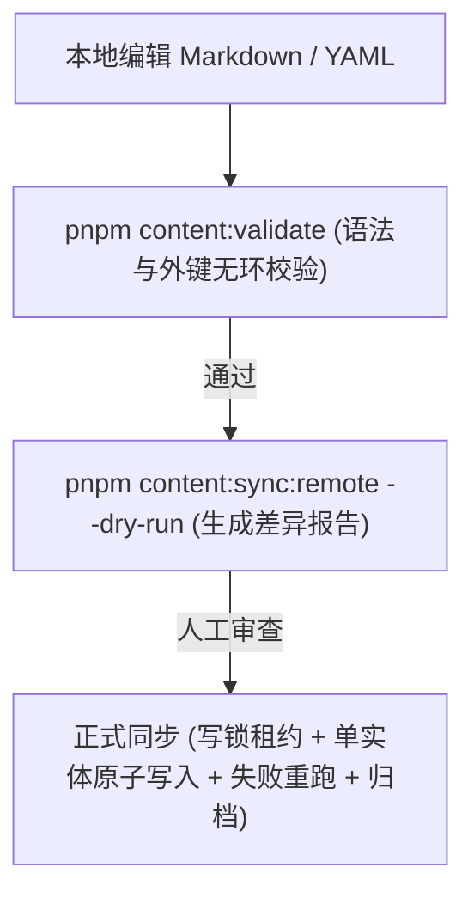

# 11408 Study — 部署与运维指南 (Deployment and Operations Guide)

> 版本：v1.0.0  
> 适用架构：Cloudflare Workers (SPA + Hono API) + Cloudflare D1 + Better Auth (Passkey-only)

---

## 1. 架构概览与关键约束

1. **单仓库、单 Worker 统一交付**：
   - 前端 Vue 3 SPA 作为静态资源（Assets）托管。
   - 后端 `/api/*` 路由运行于同一个 Cloudflare Worker 之上。
   - 内部答案/解析图片前缀 `/_solutions/*` 受鉴权保护，严禁公开访问。
2. **Passkey-Only 认证体系**：
   - 全系统无密码、无短信验证码、无第三方社交登录、无公开注册。
   - 用户必须通过管理员在服务端生成的一次性高熵邀请码（`enrollment_invites`）绑定首枚 Passkey。
   - WebAuthn 严格依赖标准 HTTPS 域名与预配置的有效 RP ID（Relying Party ID）。
3. **Git-First 内容源与 D1 查询隔离**：
   - 知识点与题目以 Markdown + YAML Frontmatter 在 Git 中版本化维护。
   - 前端不打包题目及答案，所有作答与判定均经由服务端 API 处理，保证答案提交前绝对不泄露。

---

## 2. Cloudflare 生产资源准备

### 2.1 创建生产 D1 数据库

在正式上线前，通过 Wrangler CLI 创建远程生产 D1 实例：

```bash
wrangler d1 create 11408-study-prod
```

终端将输出数据库信息，例如：

```text
✅ Successfully created DB '11408-study-prod' with ID 'xxxxxxxx-xxxx-xxxx-xxxx-xxxxxxxxxxxx'
```

### 2.2 配置 `wrangler.jsonc`

将获得的生产数据库 ID 填入 `wrangler.jsonc` 的生产环境配置（或替换环境变量中的配置）：

```jsonc
{
  "name": "11408-study",
  "main": "server/index.ts",
  "compatibility_date": "2026-10-19",
  "compatibility_flags": ["nodejs_compat"],
  "assets": {
    "binding": "ASSETS",
    "not_found_handling": "single-page-application",
    "run_worker_first": ["/api/*", "/_solutions/*"],
  },
  "d1_databases": [
    {
      "binding": "DB",
      "database_name": "11408-study-prod",
      "database_id": "<YOUR-PROD-DATABASE-ID>",
      "migrations_dir": "migrations",
    },
  ],
  "vars": {
    "APP_ENV": "production",
    "AUTH_BASE_URL": "https://study.example.com",
    "AUTH_RP_ID": "study.example.com",
  },
  "observability": { "enabled": true },
}
```

> [!IMPORTANT]
> **域名与 RP ID 必须严格一致**：WebAuthn 凭证与创建时的 `RP ID`（例如 `study.example.com`）强绑定。一旦上线，如果随意更改域名或 RP ID，已注册的用户 Passkey 将全部无法通过验证！

### 2.3 设置生产密钥 (Secret)

生产环境绝不能将 `BETTER_AUTH_SECRET` 明文写入 Git 仓库。使用 Wrangler Secret 命令录入：

```bash
# 生成高熵随机字符串（至少 32 字节 hex/base64）
openssl rand -hex 32

# 注入 Cloudflare Worker Secrets
wrangler secret put BETTER_AUTH_SECRET
```

---

## 3. 生产数据库迁移 (Database Migrations)

在任何代码部署之前，必须先将数据表结构应用到生产 D1：

```bash
# 检查待执行迁移
wrangler d1 migrations list DB --remote

# 执行远程迁移（操作前务必确认环境与数据库 ID）
wrangler d1 migrations apply DB --remote
```

迁移清单包含：

- `0000_overrated_toad.sql`: Better Auth 认证主表（`user`, `session`, `account`, `passkey` 等）
- `0001_real_moonstone.sql`: 访问控制与审计表（`enrollment_invites`, `user_access`, `auth_audit_events`）
- `0002_auth_guards.sql`: 原子注册与安全触发器（邀请消费原子锁、删除最后凭证拦截触发器）
- `0003_content_and_study.sql`: 知识点、题目版本、做题会话、客观/主观题尝试与错题状态表

---

## 4. 首次启动与管理员邀请注册

由于系统禁止公开注册，首个管理员账户必须由管理员 CLI 脚本在生产环境直接创建：

### 4.1 创建初始管理员账户

```bash
node --experimental-strip-types scripts/admin.ts create-user \
  --name "系统管理员" \
  --email "admin@study.example.com" \
  --env remote
```

### 4.2 生成首次注册一次性邀请码

```bash
node --experimental-strip-types scripts/admin.ts invite \
  --email "admin@study.example.com" \
  --purpose enrollment \
  --env remote
```

命令将输出一次性高熵邀请链接，格式形如：

```text
https://study.example.com/enroll?token=xxxxxxxxxxxxxxxxxxxxxxxxxxxxxxxx
```

### 4.3 浏览器绑定首次 Passkey 与备用 Passkey

1. 在受支持的现代浏览器（Chrome、Safari、Edge 等）打开该邀请链接。
2. 触发系统生物识别（Face ID、Touch ID、Windows Hello 或 YubiKey 硬件密钥）。
3. 凭证成功入库，邀请自动标记为已消费。
4. 登录后进入“设置”页面，点击“添加新 Passkey”，为账户绑定第二枚设备凭证，防止单设备丢失风险。

---

## 5. 内容发布与同步工作流 (Content Deployment)

所有复习资料（知识点与题目）均在 `content/` 目录下以 Markdown 和 YAML 形式维护。发布内容包含两道防线：



### 5.1 本地静态校验

```bash
pnpm content:validate
```

校验内容包括：

- `topics.yaml` 与 `tags.yaml` 是否存在 ID 重复、不存在的父节点或循环引用；
- Markdown 前分区是否合法（题干 `## 题目`、解析 `## 解析` 必须存在且仅出现一次）；
- 选项与答案一致性：单选/多选是否有序、正确答案是否有效；
- 结构化年份与标签是否冲突。

### 5.2 远程干跑（Dry-Run）审核

```bash
pnpm content:sync:remote
```

`--dry-run` 模式会对比本地 Git 内容哈希与远程 D1 数据库记录，输出受影响的知识点、题目版本变更及将被归档的废弃题目数量，**绝不产生实质写入**。

### 5.3 正式执行远程同步

在人工确认 Dry-Run 输出无误后，执行正式写入：

```bash
node --experimental-strip-types scripts/content-sync.ts --remote --env remote
```

**同步安全机制**：

- **单例写锁**（`content_sync_lock`）：租约时效机制，防止并发同步产生脏读脏写。
- **单实体原子性**：每道题作为一个独立批次更新；若中途某道题出错，已成功的题目保留版本递增，失败项可安全重跑。
- **归档滞后原则**：缺失内容的软归档（`active = 0`）只有在所有新增和更新实体全部成功入库后才会启动。
- **历史做题记录不受破坏**：旧答题记录牢固绑定至不可变的 `(question_id, revision)`，内容更新不会改写用户历史提交。

---

## 6. 灾难恢复与备份策略 (Backup & Disaster Recovery)

> [!CAUTION]
> Git 保存的是复习资料源码，**不是用户的做题记录与学习聚合数据**！必须建立定期的数据库备份机制。

### 6.1 D1 Time Travel 特性

Cloudflare D1 内置了基于分布式事务日志的 Time Travel 恢复机制：

- **保留周期**：Free 套餐支持回溯 7 天，Workers Paid 套餐支持回溯 30 天。
- **获取当前时间书签**：
  ```bash
  wrangler d1 time-travel info 11408-study-prod
  ```
- **回滚数据库到指定时间点**：
  ```bash
  wrangler d1 time-travel restore 11408-study-prod --bookmark <BOOKMARK-ID>
  ```
  _(注：该操作会将远程数据库重置到历史快照，建议在演练前先执行 SQL 导出)_

### 6.2 定期受控 SQL 导出与离线归档

建议设置每周或每日定时任务执行远程 SQL 导出：

```bash
wrangler d1 export 11408-study-prod --remote --output ./backups/11408-study-$(date +%Y%m%d).sql
```

将导出的 SQL 文件放入受加密保护的云存储（如 Cloudflare R2 私有桶、AWS S3 具备 KMS 加密桶）。

### 6.3 隔离环境还原演练步骤

严禁直接在生产库测试还原！演练必须在全新的隔离 D1 实例中验证：

1. 创建演练专用临时数据库：
   ```bash
   wrangler d1 create 11408-study-drill
   ```
2. 导入备份 SQL：
   ```bash
   wrangler d1 execute 11408-study-drill --file ./backups/11408-study-backup.sql --remote
   ```
3. 核对数据完整性：
   ```bash
   wrangler d1 execute 11408-study-drill --command "SELECT count(*) FROM attempts; SELECT count(*) FROM user_question_state;" --remote
   ```
4. 演练完毕后销毁临时库：
   ```bash
   wrangler d1 delete 11408-study-drill
   ```

### 6.4 用户凭证丢失恢复 (Passkey Recovery)

若用户丢失所有 Passkey 设备（如手机与电脑均遗失）：

1. 管理员通过 CLI 发起账户恢复，生成 `recovery` 目的的邀请码并重置账户为 `recovery_pending`：
   ```bash
   node --experimental-strip-types scripts/admin.ts invite \
     --email "user@study.example.com" \
     --purpose recovery \
     --env remote
   ```
2. 发起恢复后，旧会话与旧凭证被隔离，无法再进入系统。
3. 用户使用恢复链接在新设备重新注册绑定 Passkey，恢复完成后旧作答历史完好保留，账户恢复活跃状态。

---

## 7. 运行监控与性能指标 (Monitoring & SLA)

### 7.1 Cloudflare Dashboard 核心监控项

- **Worker CPU Time**：
  - Free 套餐单个请求 CPU 耗时上限为 50ms。
  - WebAuthn 注册与登录包含 ASN.1 校验和签名验证，若 CPU 耗时持续逼近 35ms-45ms，必须将 Worker 升级至 Paid 套餐（支持单次 30000ms CPU），**严禁通过降低安全校验或跳过密码学验证来换取性能**。
- **Worker 1102 错误（Worker Exceeded CPU Limit）**：
  - 若出现 1102 警报，说明个别复杂知识点 Markdown 转换或过大 SQL 查询发生阻塞。
- **D1 响应延迟与查询计划**：
  - 重点监控 `user_question_state` 和 `attempts` 历史查询。系统已建立 `(user_id, question_id)` 和 `(session_id, ordinal)` 联合索引，查询必须走 Index Seek，杜绝全表扫描。
- **429 Rate Limited 计数**：
  - 监控 `/api/v1/enrollment/options` 与 `/api/auth/passkey/generate-authentication-options` 是否遭受恶意爆破。

---

## 8. 上线检查清单 (Go-Live Checklist)

- [ ] 生产 D1 数据库已创建并在 `wrangler.jsonc` 中正确绑定。
- [ ] 数据库迁移 `0000` 至 `0003` 已在远程全部成功应用。
- [ ] `BETTER_AUTH_SECRET` 已通过 `wrangler secret put` 录入，未泄露在代码库中。
- [ ] 线上 HTTPS 域名配置完成，DNS 与 SSL 证书状态正常。
- [ ] `wrangler.jsonc` 中的 `AUTH_BASE_URL` 与 `AUTH_RP_ID` 与线上域名严格对应。
- [ ] 执行 `pnpm content:validate` 验证内容规范。
- [ ] 执行 `pnpm content:sync:remote --dry-run` 审核远程发布差异。
- [ ] 通过 `scripts/admin.ts` 创建初始用户并生成真实邀请。
- [ ] 真实手机/电脑设备通过邀请成功绑定 Passkey 并完成单次完整练习与错题自评测试。
- [ ] 验证未授权访问 `/api/v1/*` 正确返回 401，未提交答案前无法获取解析。
